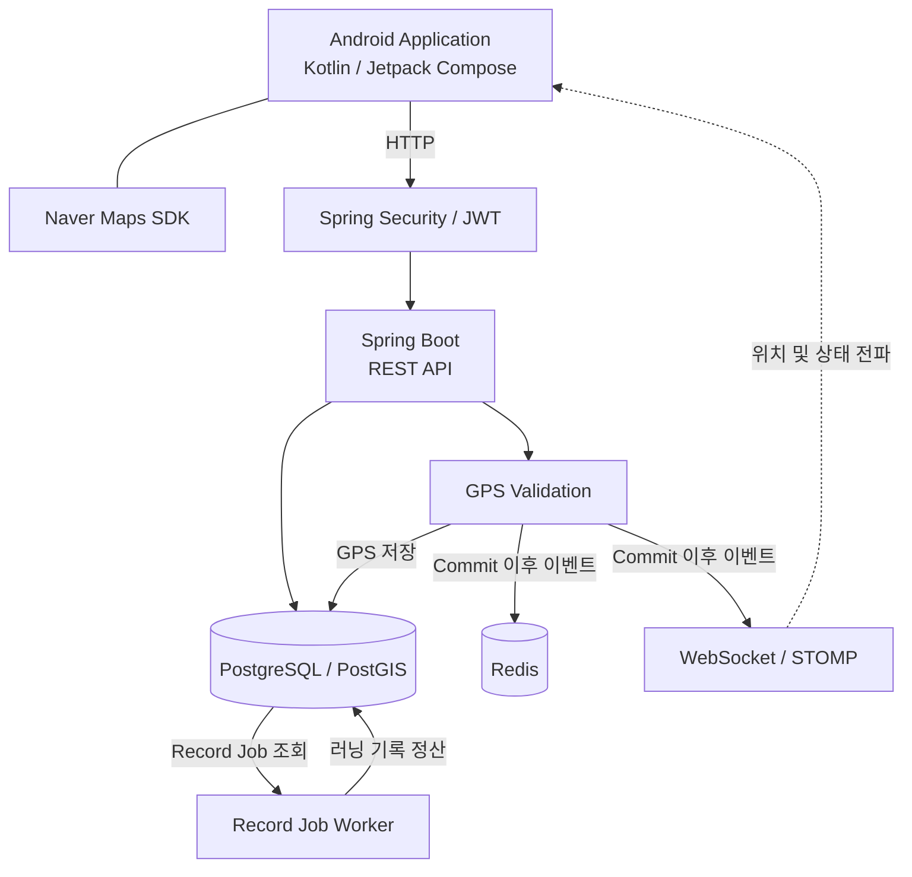
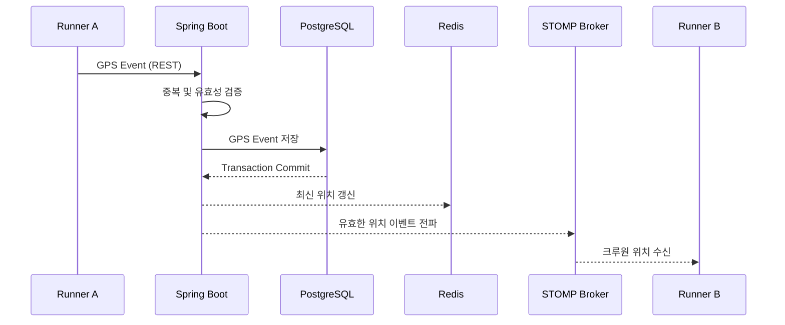
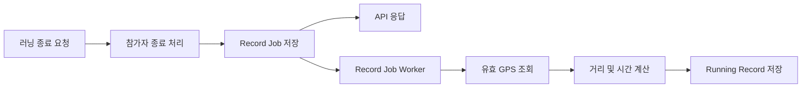

# 🏃 달모이 (Dalmoi)

**각자의 페이스로, 함께 달리는 즐거움 — 그룹 러닝 플랫폼 달모이**

달모이는 지도에서 직접 러닝 코스를 만들고, 크루원과 코스를 공유하며 함께 달릴 수 있는 그룹 러닝 서비스입니다.

같은 코스에서 각자의 페이스로 달리고, 주행 기록을 관리할 수 있는 러닝 경험을 제공합니다.

## 1. 프로젝트 소개

### 기획 배경

기존 러닝 서비스는 개인의 운동 기록과 성과 관리에 집중하는 경우가 많습니다.

달모이는 개인마다 다른 러닝 페이스를 존중하면서도, 크루원들이 같은 코스를 공유하고 함께 운동할 수 있는 환경을 제공하고자 시작한 프로젝트입니다.

### 핵심 목표

- 지도 기반 사용자 정의 러닝 코스 생성
- 크루 단위의 그룹 러닝
- WebSocket 기반 실시간 위치 공유
- GPS 데이터 검증을 통한 신뢰성 있는 운동 기록 관리
- 동시성과 데이터 정합성을 고려한 백엔드 설계

## 2. 주요 기능

| 기능 | 설명 |
| --- | --- |
| 회원 관리 | 회원가입, 로그인 및 JWT 기반 인증 |
| 코스 관리 | 지도에서 직접 러닝 코스를 생성하고 저장 |
| 크루 관리 | 초대코드를 통한 비공개 러닝 크루 생성 및 가입 |
| 그룹 러닝 | 공통 코스를 선택하고 러닝 세션 생성 및 참여 |
| 개인 러닝 | 그룹 내에서 각자의 페이스에 맞춰 출발 및 종료 |
| 위치 공유 | WebSocket 기반 참가자 위치 및 상태 전파 |
| 러닝 기록 | 검증된 GPS 데이터를 기반으로 거리, 시간, 경로 조회 |

> 현재 위치 공유 기능은 백엔드 구현이 완료되어 있으며, Android의 GPS 좌표 수집·전송 및 실시간 지도 표시 연동은 후속 개발 범위입니다.

## 3. 기술 스택

### Backend

| 구분 | 기술 |
| --- | --- |
| Language | Java 25 |
| Framework | Spring Boot 4.1.2 |
| ORM | Spring Data JPA, Hibernate Spatial |
| Security | Spring Security, JWT |
| Database | PostgreSQL, PostGIS |
| Cache | Redis |
| Real-time | WebSocket, STOMP |
| Migration | Flyway |
| API Documentation | Swagger, OpenAPI |
| Test | JUnit, Testcontainers |
| Build | Gradle |

### Android

| 구분 | 기술 |
| --- | --- |
| Language | Kotlin |
| UI | Jetpack Compose, Material 3 |
| State Management | ViewModel, Kotlin Coroutines |
| Network | Ktor Client, OkHttp |
| Map | Naver Maps SDK |
| Navigation | Navigation Compose |

### Infrastructure & CI

| 구분 | 기술 |
| --- | --- |
| Container | Docker, Docker Compose |
| CI | GitHub Actions |
| Code Quality | Spotless, Checkstyle, Ktlint, Android Lint |
| Development Network | Tailscale |

## 4. 시스템 아키텍처



현재 백엔드는 단일 서버 구조로 구성되어 있습니다. GPS 이벤트는 PostgreSQL에 영속화하고, Redis는 최신 위치 캐시로 활용합니다.

실시간 위치 전파와 러닝 기록 정산을 분리하여 각각의 책임을 명확하게 관리합니다.

## 5. 핵심 기술적 구현

### 5.1 GPS 이벤트의 멱등성 보장

**Problem**

모바일 네트워크의 불안정성으로 동일한 GPS 이벤트가 여러 번 전송될 수 있으며, 중복 저장은 러닝 거리 계산의 정확도를 저하시킬 수 있습니다.

**Solution**

- GPS 이벤트마다 고유한 `eventId` 부여
- 동일한 이벤트와 요청 데이터가 재전송되면 기존 처리 결과 반환
- 동일 ID에 서로 다른 요청 데이터가 들어오면 충돌 처리
- 참가자별 `sequence`를 활용한 중복 및 순서 검증

**Result**

재전송 상황에서도 동일한 GPS 이벤트가 중복 반영되지 않도록 데이터 정합성을 확보했습니다.

### 5.2 GPS 이상 데이터 필터링

**Problem**

GPS 측정 오차, 좌표 순서 역전 및 비정상적인 위치 이동으로 실제 운동 거리와 기록된 거리 사이에 차이가 발생할 수 있습니다.

**Solution**

수신한 GPS 이벤트를 다음 기준으로 검증합니다.

| 검증 기준 | 처리 내용 |
| --- | --- |
| LOW_ACCURACY | 정확도가 기준에 미달하는 좌표 제외 |
| LATE_SEQUENCE | 이전 이벤트보다 늦게 도착한 순번 제외 |
| TIME_REVERSED | 측정 시간이 역전된 데이터 제외 |
| UNREALISTIC_SPEED | 비정상적인 이동 속도를 가진 좌표 제외 |
| Timestamp Validation | 허용 시간 범위를 벗어난 요청 거부 |

검증에 통과한 GPS 데이터만 실시간 위치 공유 및 러닝 기록 정산에 활용합니다.

### 5.3 Redis 기반 최신 위치 캐싱

**Problem**

그룹 러닝 중 참가자의 최신 위치를 반복적으로 조회하면 데이터베이스에 조회 부하가 집중될 수 있습니다.

**Solution**

- Redis를 최신 GPS 위치 캐시로 활용
- PostgreSQL에 원본 GPS 이벤트 영속화
- 최신 위치 조회와 전체 이동 이력 저장의 역할 분리
- 유효한 GPS 데이터를 기반으로 위치 정보 갱신

Redis는 빠른 위치 조회를 담당하고, PostgreSQL은 신뢰성 있는 원본 데이터 저장을 담당하도록 설계했습니다.

### 5.4 WebSocket 기반 실시간 위치 공유

**Problem**

HTTP Polling 방식은 위치 변경 여부와 관계없이 반복적인 요청이 발생하며, 실시간 위치 공유에서 불필요한 네트워크 비용을 발생시킬 수 있습니다.

**Solution**

- WebSocket/STOMP 기반 서버 푸시 구조 구현
- GPS 데이터는 REST API를 통해 수신
- DB 트랜잭션 커밋 이후 유효한 위치 이벤트 전파
- STOMP CONNECT 단계에서 JWT 인증
- SUBSCRIBE 단계에서 러닝 세션 접근 권한 검증



위치 전파 시 DB 트랜잭션 커밋 이후 이벤트를 처리하여 롤백된 데이터가 사용자에게 전달되는 문제를 방지하도록 구성했습니다.

### 5.5 비관적 락을 활용한 동시성 제어

**Problem**

크루원이 동시에 러닝을 시작하거나 종료하고, GPS 데이터를 전송하는 상황에서 상태 충돌 및 중복 데이터가 발생할 수 있습니다.

**Solution**

- 크루, 회원, 러닝 세션 및 참가자 단위 비관적 락 적용
- 크루별 활성 러닝 세션 중복 생성 방지
- 동일 사용자의 동시 러닝 참여 방지
- GPS 수신과 개인 러닝 종료 간 동시성 제어
- 데이터베이스 제약조건을 통한 추가적인 정합성 보장

애플리케이션 검증과 데이터베이스 수준의 동시성 제어를 함께 적용했습니다.

### 5.6 DB 기반 비동기 러닝 기록 정산

**Problem**

러닝 종료 요청과 동시에 전체 GPS 데이터를 조회하고 이동 거리를 계산하면 API 응답이 지연될 수 있습니다.

**Solution**

러닝 종료와 기록 정산을 분리했습니다.



- 러닝 종료 트랜잭션에서 정산 작업 생성
- 종료 시점의 GPS 수신 순번을 기준으로 정산 범위 확정
- 별도의 Worker가 정산 작업 처리
- 작업 실패 시 재처리 가능한 구조
- 참가자별 중복 러닝 기록 생성 방지

별도의 메시지 브로커 없이 DB 기반 정산 작업을 구현했으며, 향후 Kafka 기반 이벤트 처리 구조로 확장할 수 있습니다.

### 5.7 PostGIS 기반 공간 데이터 관리

러닝 코스 및 GPS 좌표를 공간 데이터로 관리하기 위해 PostgreSQL의 PostGIS와 Hibernate Spatial을 활용했습니다.

- 지도 기반 러닝 코스 저장
- GPS 좌표의 공간 데이터 관리
- 좌표 간 거리 계산
- 유효 GPS 이벤트 기반 실제 이동 경로 관리

## 6. 프로젝트 구조

```text
dalmoi/
├── android/
│   ├── app/
│   └── gradle/
│
├── backend/
│   ├── src/main/java/com/sor999/dalmoi/
│   │   ├── auth/
│   │   ├── member/
│   │   ├── course/
│   │   ├── crew/
│   │   ├── session/
│   │   ├── gps/
│   │   ├── record/
│   │   ├── home/
│   │   └── global/
│   ├── src/main/resources/
│   │   └── db/migration/
│   ├── src/test/
│   ├── compose.yaml
│   └── build.gradle
│
├── .github/workflows/
├── scripts/
├── DESIGN.md
├── AGENTS.md
└── README.md
```

Android와 Backend를 하나의 저장소에서 관리하는 Monorepo 구조를 사용합니다.

백엔드는 도메인 중심으로 패키지를 분리하여 기능별 책임과 유지보수성을 고려했습니다.

## 7. 테스트 및 코드 품질

Testcontainers를 활용하여 실제 PostgreSQL 및 Redis 환경을 기반으로 백엔드 통합 테스트를 구성했습니다.

주요 검증 대상은 다음과 같습니다.

- GPS 이벤트 중복 및 이상 데이터 처리
- 크루 및 러닝 세션 상태 관리
- 최신 위치 캐시
- WebSocket 인증 및 위치 공유
- 러닝 기록 정산
- JWT 인증

GitHub Actions를 통해 Android 및 Backend의 테스트와 코드 품질 검증을 자동화합니다.

## 8. 실행 방법

### Backend

Requirements: JDK 25, Docker Compose, OpenSSL

```bash
git clone https://github.com/sor999/dalmoi.git
cd dalmoi/backend

[ -f .env ] || cp .env.example .env

set -a
. ./.env
set +a

export JWT_SECRET="${JWT_SECRET:-$(openssl rand -base64 32)}"

docker compose up -d --wait

./gradlew bootRun
```

- Backend: http://localhost:8080
- Swagger UI: http://localhost:8080/swagger-ui.html

### Android

Android Studio에서 `android/` 디렉터리를 열고 JDK 25 및 Android SDK 37을 설정합니다.

`android/local.properties`에 네이버 지도 클라이언트 ID를 추가합니다.

```properties
dalmoi.naverMapKeyId=YOUR_NAVER_MAPS_CLIENT_ID
```

Android 에뮬레이터의 기본 API 주소:

```text
http://10.0.2.2:8080/api/v1/
```

실제 기기에서 Tailscale을 활용하여 테스트하는 경우:

```bash
cd android

./gradlew :app:assembleDebug \
  -Pdalmoi.apiBaseUrl=https://YOUR-BACKEND.YOUR-TAILNET.ts.net/api/v1/
```

### Test

Backend:

```bash
./gradlew test spotlessCheck checkstyleMain checkstyleTest bootJar
```

Android:

```bash
./gradlew :app:testDebugUnitTest spotlessCheck androidLint :app:assembleDebug
```

## 10. 프로젝트 문서

- [기능 요구사항 정의서 (SRS)](https://app.notion.com/p/hyunje/Dalmoi-SRS-4151e1ec7daf8047a86ced015e0d3521)
- [디자인 시스템](DESIGN.md)
- [개발 가이드](AGENTS.md)

## 11. Developer

| GitHub |
| --- |
| [@sor999](https://github.com/sor999) |
