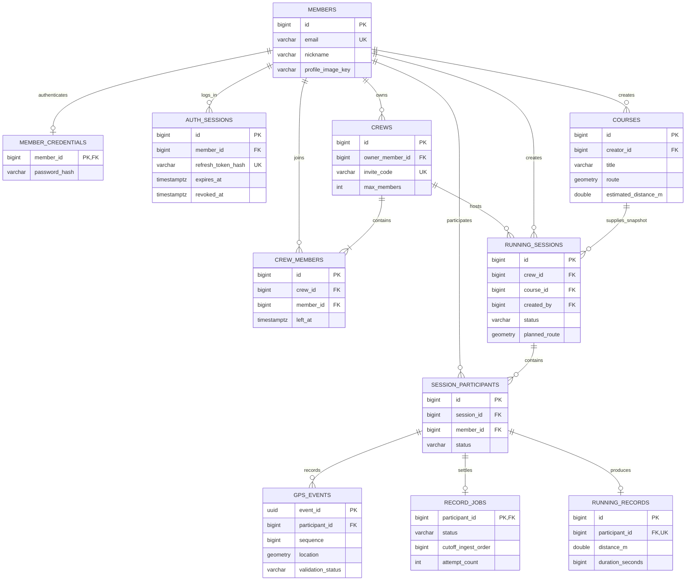
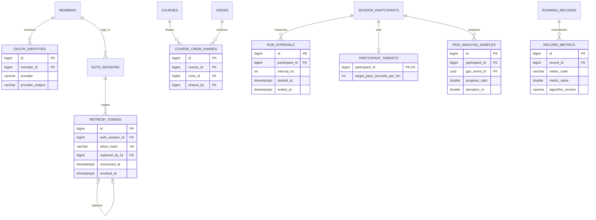

# 달모이(Dalmoi) ERD 설계 — MVP / MVP 이후

> 설계 기준일: 2026-11-16. 이 문서는 **구현 제안**이며 DB 마이그레이션 적용 완료를 의미하지 않는다.
> 목표: 2주 MVP의 핵심 흐름을 구현하고, 이후 기능은 기존 식별자와 관계를 유지하면서 테이블·컬럼을 추가한다.

## 1. 근거와 범위

- [API 명세서 v1.4](https://app.notion.com/p/hyunje/API-4191e1ec7daf80fa9e90f63efcaa39e4): P0 API 전체 목록, 5절 상태 모델, 6절 GPS 처리, 8절 기록 정산, 11절 후속 API, 14절 화면 계약을 기준으로 한다.
- [기능 요구사항 정의서 SRS v1.1](https://app.notion.com/p/4151e1ec7daf8047a86ced015e0d3521): 권한, 데이터 관리 원칙, P1/P2 범위를 보완한다.
- API의 최신 보정이 우선한다. **MVP Refresh Token Rotation 없음**, 코스 좌표는 출발·도착 포함 **2~50개**, `pointCount` 필수 컬럼 없음, 소셜 로그인은 P1이다.
- 로그아웃 P0는 API의 권장 제안이다. SRS의 P1 분류와 차이가 있으므로 범위 합의가 필요하다. 이 설계에는 현재 세션 폐기 저장 구조를 포함한다.
- 후속 API의 요청·응답과 세부 정책은 미확정이다. 아래 P1/P2 테이블은 확장 제안이며 MVP 필수 구현 대상이 아니다.

현재 저장소는 Spring Boot/JPA, PostgreSQL, Flyway, `ddl-auto: validate` 설정을 사용하며 도메인 구현 전 단계다. PostGIS·Kafka·Redis는 명세의 목표 구성이다. 이 문서는 의존성 추가나 인프라 구축을 수행하지 않는다.

## 2. 구조 선택

| 선택 | MVP에서 하는 일 | 이후 변경을 줄이는 이유 |
| --- | --- | --- |
| 사용자와 인증 수단 분리 | `members` + `member_credentials` | 소셜 로그인은 별도 identity 추가로 확장 |
| 로그인 세션 분리 | 기기별 `auth_sessions`에 Refresh 해시 보관 | Rotation 이력을 별도 추가, 사용자 PK 유지 |
| 크루 가입과 러닝 참가 분리 | `crew_members`와 `session_participants` 독립 | 탈퇴 이후에도 참가·기록 이력 유지 |
| 세션 계획 코스 스냅샷 | 세션에 경로·거리·코스명 복사 | 원본 코스 수정·삭제로 과거 계획이 바뀌지 않음 |
| 주행 상태와 정산 상태 분리 | 참가자 상태 + `record_jobs` | FINISHED 이후 PROCESSING/FAILED를 표현 |
| 계획 경로와 실제 경로 분리 | 계획은 LineString, 실제는 GPS 이벤트 행 | 시간·순번·품질 정보를 잃지 않고 재정산 가능 |
| 크루장 단일 기준 | `crews.owner_member_id`에서 OWNER 계산 | 역할 컬럼과 소유자 불일치 방지, 위임 시 한 곳 수정 |
| 집계 응답을 저장 모델과 분리 | 홈·인원·참가 여부는 조회로 계산 | API 화면마다 테이블을 만들지 않음 |

스냅샷은 코스 버전 테이블보다 MVP 구현이 간단하다. 공유 세션당 한 번만 복사하며 참가자별로 경로를 중복 저장하지 않는다. 코스 수정·삭제가 도입되어도 이 방식을 유지할 수 있다.

## 3. 공통 표기와 타입

- `PK`: 기본키, `FK`: 외래키, `UQ`: 고유 제약. 컬럼은 별도 표시 없으면 NOT NULL, `?`는 NULL 허용이다.
- 일반 엔티티 PK는 `bigint GENERATED BY DEFAULT AS IDENTITY` 제안. API 숫자 ID와 Java `Long`에 맞춘다. GPS의 `event_id`만 클라이언트가 생성한 UUID다.
- 시간은 `timestamptz`, UTC 기준 저장·전송. 거리 계산 결과는 **미터 `double precision`**로 보관하고 API에서 km로 변환·소수 둘째 자리 표시한다. 중간 거리 합산에서 반올림하지 않는다.
- 공간 타입은 `geometry(LineString,4326)`, `geometry(Point,4326)`. PostGIS 좌표 순서는 **X=longitude, Y=latitude**. 거리(m)는 geography 변환 등 지표면 거리 계산으로 구한다. geometry 4326의 각도 값을 m로 해석하지 않는다.
- 상태는 `varchar(24)` + CHECK 제안. 후속 상태 추가는 CHECK 변경으로 처리한다. JPA ordinal 저장은 사용하지 않는다.
- 문자열 길이·소수 정밀도 등 아래 물리 타입은 설계 제안이다. 이메일 정규화·닉네임/제목 길이 정책은 구현 전 확정한다.
- FK 삭제는 기본 `RESTRICT`/`NO ACTION`. 크루 탈퇴·코스 삭제가 기록 연쇄 삭제를 일으키지 않게 한다. 개인정보 삭제는 별도 정책과 명시적 삭제 작업으로 처리한다.

## 4. MVP ERD

아래는 관계와 핵심 컬럼을 보여준다. 전체 컬럼·제약은 5절을 기준으로 한다. Redis는 관계형 FK 대상이 아니므로 ERD에 넣지 않는다.



MVP 테이블은 11개다. `member_credentials`는 이메일 가입 시 반드시 한 행을 만들지만, 소셜 전용 계정에 대비해 관계 자체는 0..1로 둔다. `crews`의 소유자는 활성 멤버여야 하며 이는 생성·가입 트랜잭션에서 보장한다.

## 5. MVP 테이블 상세

### 5.1 `members` — 서비스 회원

| 컬럼 | 타입 | 제약·설명 |
| --- | --- | --- |
| id | bigint | PK |
| email | varchar(254) | UQ, MVP 필수. 공백 제거·대소문자 정책 적용 후 저장 |
| nickname | varchar(50) | 공백만 입력 불가, 고유 조건 없음 |
| profile_image_key | varchar(1024)? | S3 프로필 이미지 객체 키. 애플리케이션 속성명은 profileImageKey. 이미지가 없으면 NULL |
| created_at | timestamptz | 가입 시각 |
| updated_at | timestamptz | 수정 시각 |

`email`의 정규화 결과에 UQ를 적용한다. 소셜 이메일만 같다는 이유로 자동 계정 통합하지 않는다. 이메일 미제공 소셜 계정을 허용하면 P1에서 `email` NULL 허용으로 확장한다.

프로필 이미지는 URL 대신 S3 객체 키(`profile_image_key`)를 저장하고, 응답 구성 시 키를 기반으로 화면 표시용 `profileImageUrl`을 제공한다. 생성한 URL은 DB에 저장하지 않는다. MVP에서는 프로필 이미지를 화면 표시 용도로만 사용하고 인증·권한·러닝 등 도메인 로직에는 사용하지 않는다. 키가 NULL이면 `profileImageUrl`도 NULL로 내려 화면에서 기본 이미지를 표시한다. 업로드·변경 API는 이번 설계 변경에 포함하지 않는다.

용어는 도메인 `Member`, 테이블 `members`, 회원 FK `member_id`로 통일한다. `crew_members.id`는 크루 가입 식별자이고 `crew_members.member_id`는 서비스 회원 식별자다. 원본 API의 `/users/me`, `userId`, 가입 응답의 `memberId` 및 Kafka key의 `userId`는 기존 계약 표기다. 문서의 DB 용어 변경과 구분하며, API도 변경할 때는 가입 식별자를 `crewMemberId` 등으로 구분하고 서버·Android 계약을 함께 조정한다. `profileImageUrl`은 화면 제공을 위한 응답 필드 추가 제안이다.

### 5.2 `member_credentials` — 이메일 비밀번호 인증

| 컬럼 | 타입 | 제약·설명 |
| --- | --- | --- |
| member_id | bigint | PK, FK → members.id |
| password_hash | varchar(255) | 단방향 비밀번호 해시, 원문 저장 금지 |
| password_changed_at | timestamptz | 가입 시 초기화 |

### 5.3 `auth_sessions` — 로그인 단위 Refresh 세션

| 컬럼 | 타입 | 제약·설명 |
| --- | --- | --- |
| id | bigint | PK, 러닝 세션 ID와 구분 |
| member_id | bigint | FK → members.id |
| refresh_token_hash | varchar(128) | UQ, 난수 토큰의 해시/HMAC만 저장 |
| issued_at | timestamptz | 최초 발급 시각 |
| expires_at | timestamptz | 최초 발급 기준 고정 만료 |
| revoked_at | timestamptz? | 로그아웃 폐기, NULL이면 미폐기 |

CHECK `expires_at > issued_at`. 로그인마다 한 행 생성하여 여러 기기를 분리한다. MVP 갱신은 해시·만료·폐기를 검증하고 **이 행을 교체하거나 만료를 연장하지 않는다**. JWT 원문은 DB에 저장하지 않는다. Access 만료 30분·Refresh 14일은 명세의 초기 권장값이다. Refresh 폐기만으로 기존 Access JWT가 즉시 무효화되지는 않는다.

### 5.4 `courses` — 개인 계획 코스

| 컬럼 | 타입 | 제약·설명 |
| --- | --- | --- |
| id | bigint | PK |
| creator_id | bigint | FK → members.id |
| title | varchar(100) | 공백만 입력 불가 |
| route | geometry(LineString,4326) | 입력 좌표 순서를 그대로 보존 |
| estimated_distance_m | double precision | 서버 계산, CHECK >= 0 |
| is_loop | boolean | 서버 판정, 거리 임계치 합의 필요 |
| created_at | timestamptz | 생성 시각 |
| updated_at | timestamptz | 수정 시각, MVP에는 생성 시각과 동일 |
| deleted_at | timestamptz? | P1 삭제 대비, MVP NULL |

`ST_NPoints(route) BETWEEN 2 AND 50` 및 위경도 범위를 검증한다. `ST_IsValid`만으로 위경도 범위를 보장하지 않는다. `ST_DumpPoints`를 순서대로 반환해 points 배열을 복원한다. 편집점은 체크포인트가 아니므로 별도 waypoint 테이블을 만들지 않는다. 원본 배열·LineString을 동시에 정본으로 저장하지 않는다.

### 5.5 `crews` — 비공개 크루

| 컬럼 | 타입 | 제약·설명 |
| --- | --- | --- |
| id | bigint | PK |
| name | varchar(100) | 공백만 입력 불가 |
| owner_member_id | bigint | FK → members.id, OWNER 판정의 정본 |
| invite_code | varchar(32) | UQ, 서버 생성·충돌 시 재생성 |
| max_members | smallint | DEFAULT 10, CHECK > 0, MVP 명령에서 10 고정 |
| created_at | timestamptz | 생성 시각 |
| updated_at | timestamptz | 수정 시각 |

초대코드는 크루장에게 재표시해야 하므로 토큰과 달리 복원 가능한 값으로 보관한다. 길이·만료·재발급 정책은 미정이며 코드 원문을 일반 목록·로그에 노출하지 않는다.

### 5.6 `crew_members` — 크루 가입

| 컬럼 | 타입 | 제약·설명 |
| --- | --- | --- |
| id | bigint | PK, 가입 응답의 memberId |
| crew_id | bigint | FK → crews.id |
| member_id | bigint | FK → members.id |
| joined_at | timestamptz | 가입 시각 |
| left_at | timestamptz? | 활성 가입은 NULL, P1 탈퇴 대비 |

활성 가입만 `(crew_id,member_id)` UQ를 적용한다. P1 재가입은 새 가입 행을 만들어 과거 이력을 보존한다. 세션 참가자는 가입 행에 종속시키지 않아 탈퇴 시 과거 기록이 사라지지 않는다. `role`은 저장하지 않고 owner_member_id 비교로 OWNER/MEMBER를 계산한다.

### 5.7 `running_sessions` — 크루 그룹 러닝

| 컬럼 | 타입 | 제약·설명 |
| --- | --- | --- |
| id | bigint | PK |
| crew_id | bigint | FK → crews.id |
| created_by | bigint | FK → members.id, 생성 당시 사용자 |
| course_id | bigint | FK → courses.id, 원본 추적용 |
| title | varchar(100) | 러닝명 |
| status | varchar(24) | WAITING / RUNNING / COMPLETED |
| planned_course_title | varchar(100) | 생성 시 코스명 스냅샷 |
| planned_route | geometry(LineString,4326) | 생성 시 경로 스냅샷 |
| planned_distance_m | double precision | 생성 시 거리, CHECK >= 0 |
| planned_is_loop | boolean | 생성 시 순환 판정 |
| crew_name_snapshot | varchar(100) | 기록 표시용 생성 당시 크루명 |
| created_at | timestamptz | 생성 시각 |
| started_at | timestamptz? | 그룹 시작 시각 |
| completed_at | timestamptz? | 그룹 마감 시각 |

계획 값은 **세션 생성 시부터 불변**이라는 제안이다. 원본 코스 변경 시 새 세션부터 반영한다. 상태별 시간 NULL 조합과 `completed_at >= started_at`을 CHECK로 검증한다. 세션명 변경 API는 MVP에 없으며 후속 수정 도입 시 과거 표시 정책도 정의한다.

### 5.8 `session_participants` — 개인 주행 상태

| 컬럼 | 타입 | 제약·설명 |
| --- | --- | --- |
| id | bigint | PK |
| session_id | bigint | FK → running_sessions.id |
| member_id | bigint | FK → members.id |
| status | varchar(24) | JOINED / RUNNING / FINISHED / ABSENT |
| joined_at | timestamptz | 참가 시각 |
| started_at | timestamptz? | 서버 개인 시작 시각 |
| ended_at | timestamptz? | 서버 개인 종료 시각 |

UQ `(session_id,member_id)`. JOINED·ABSENT는 시작/종료 NULL, RUNNING은 시작만 존재, FINISHED는 둘 다 존재하고 종료 >= 시작. `NOT_JOINED`는 행이 없는 크루원의 **응답 전용 상태**다. `ABSENT`는 참가했지만 그룹 마감까지 개인 시작을 안 한 행이다.

### 5.9 `gps_events` — 수신 이력·중복 판정·실제 경로

| 컬럼 | 타입 | 제약·설명 |
| --- | --- | --- |
| event_id | uuid | PK, 전체 이벤트 중복 방지 |
| participant_id | bigint | FK → session_participants.id |
| sequence | bigint | CHECK >= 0, 참가자 주행 단위 순번 |
| ingest_order | bigint | 참가자별 서버 수락 순서, 정산 장벽용 내부 값 |
| location | geometry(Point,4326) | 좌표 범위 검증 |
| accuracy_m | double precision | CHECK >= 0, NaN/Infinity 거부 |
| recorded_at | timestamptz | 단말 측정 시각 |
| received_at | timestamptz | 서버 최초 수신 시각, 지연 표시 기준 |
| validation_status | varchar(24) | PENDING / VALID / REJECTED |
| rejection_reason | varchar(64)? | 품질·시간·비현실적 이동 제외 사유 |
| processed_at | timestamptz? | 최종 검증 처리 시각 |

UQ `(participant_id,sequence)`, UQ `(participant_id,ingest_order)`. 같은 eventId 재전송은 최초 내용·소유자를 확인한다. 다른 내용/사용자로 같은 ID를 보내거나 다른 ID로 같은 순번을 보내면 충돌 처리한다. `ON CONFLICT DO NOTHING`만으로 변조를 정상 재시도로 인정하지 않는다.

API 형식 검증을 통과한 이벤트를 내구성 있게 저장하고 품질 검증 상태를 관리한다는 제안이다. REJECTED는 실제 경로·거리·최신 마커에서 제외한다. 형식이 잘못된 요청까지 보관하지 않는다. 실제 경로는 VALID 행을 `sequence` 순으로 구성하며 측정 시각 역전·점프 판정 규칙을 고정한다. 위치 보관·삭제 기간은 배포 전 별도 확정한다.

GPS 이력에는 50개 상한이 없다. 실제 경로는 시각을 포함한 점 배열로 조회하므로 단순 LineString만 저장하지 않는다. VALID 점이 0~1개면 거리 0을 허용한다.

### 5.10 `record_jobs` — 개인별 비동기 정산

| 컬럼 | 타입 | 제약·설명 |
| --- | --- | --- |
| participant_id | bigint | PK, FK → session_participants.id, 종료 때 1개 생성 |
| status | varchar(24) | PROCESSING / COMPLETED / FAILED |
| cutoff_ingest_order | bigint | 종료 전 수락한 마지막 서버 순번, 없으면 0 |
| attempt_count | integer | DEFAULT 0, CHECK >= 0 |
| error_code | varchar(64)? | 실패 시 RECORD_PROCESSING_FAILED 등 |
| requested_at | timestamptz | 정산 요청 시각 |
| updated_at | timestamptz | 마지막 처리 시각 |
| completed_at | timestamptz? | 성공 완료 시각 |

시작 전/주행 중/ABSENT에는 행이 없다. 이때 record-status 응답을 어떻게 표현할지는 명세에서 미정이므로 COMPLETED로 간주하지 않는다. 재시도 정책·한도·타임아웃은 구현 전 확정한다. MVP에 자동 복구 UI를 추가한다는 뜻은 아니다.

### 5.11 `running_records` — 최종 개인 기록

| 컬럼 | 타입 | 제약·설명 |
| --- | --- | --- |
| id | bigint | PK, API recordId |
| participant_id | bigint | FK → session_participants.id, UQ |
| distance_m | double precision | VALID 이벤트로 최종 계산, CHECK >= 0 |
| duration_seconds | bigint | 서버 ended_at - started_at, CHECK >= 0 |
| calculation_version | varchar(32) | 적용 거리·GPS 필터 알고리즘 버전 |
| created_at | timestamptz | 최종 저장 시각 |

member/session/course FK를 반복 저장하지 않고 참가자 → 세션으로 조회한다. 개인 시작·종료 시각도 참가자의 값을 사용한다. `actualRoute`는 gps_events의 VALID 행, `plannedRoute`·계획 거리는 세션 스냅샷에서 가져온다. 최초 정산 완료 후 경로 판정을 임의로 바꾸지 않는다. 보관 기간 때문에 GPS를 삭제하면 상세 경로를 계속 제공할 수 없으므로 기록·경로 보관 정책을 함께 정해야 한다.

## 6. 제약·인덱스·동시성

### 6.1 필수 고유 제약과 인덱스

아래 SQL은 **부분 인덱스 예시**이며 전체 DDL이 아니다.

```sql
CREATE UNIQUE INDEX uq_crew_members_active
    ON crew_members (crew_id, member_id) WHERE left_at IS NULL;

CREATE UNIQUE INDEX uq_running_participant_per_member
    ON session_participants (member_id) WHERE status = 'RUNNING';

CREATE UNIQUE INDEX uq_running_session_per_crew
    ON running_sessions (crew_id) WHERE status = 'RUNNING';
```

| 조회/명령 | 추가 인덱스·제약 |
| --- | --- |
| 로그인·재발급 | members.email UQ, auth_sessions.refresh_token_hash UQ, auth_sessions(member_id) |
| 내 코스 | courses(creator_id,created_at DESC,id DESC) WHERE deleted_at IS NULL |
| 내 크루 | crew_members(member_id,crew_id) WHERE left_at IS NULL |
| 크루 러닝 목록 | running_sessions(crew_id,status,created_at DESC,id DESC) |
| 세션 참가자 | session_participants(session_id,member_id) UQ |
| GPS 중복·경로 | gps_events.event_id PK, (participant_id,sequence) UQ, (participant_id,ingest_order) UQ |
| 미처리 GPS | gps_events(participant_id,ingest_order) WHERE validation_status='PENDING' |
| 정산 재확인 | record_jobs(status,updated_at) |
| 내 기록 | session_participants(member_id,ended_at DESC,id DESC) WHERE status='FINISHED'; running_records.participant_id UQ |

목록 페이징은 시간에 id를 추가해 순서를 고정한다. 공간 GiST 인덱스는 공간 검색·진행률 조회를 도입할 때 실제 쿼리에 맞춰 추가한다. MVP의 PK 조회·참가자별 경로 조회만으로 모든 공간 컬럼에 GiST를 만들지는 않는다.

### 6.2 트랜잭션 규칙

1. **크루 생성**: crews와 생성자의 crew_members를 같은 트랜잭션으로 생성한다. 소유자는 활성 멤버여야 한다. P1 소유자 탈퇴는 위임 전 거부한다.
2. **크루 가입**: crews 행 잠금 → 활성 가입 중복·COUNT < max_members 확인 → 삽입. 모든 가입 경로가 같은 잠금을 사용해야 10명 제한을 보장한다. COUNT용 CHECK로 다른 행 수를 검증할 수 없다.
3. **세션 참가·개시·마감·개인 시작/종료**: running_sessions 행을 공통 잠금 대상으로 사용한다. WAITING 검사와 참가 삽입, 참가자 수 검사와 그룹 시작, RUNNING 참가자 검사와 그룹 마감을 각각 원자 처리한다. 개인 시작과 그룹 마감도 같은 잠금에 참여해야 한다.
4. **개인 시작**: 세션 잠금 → 본인 참가자 잠금 → 조건부 JOINED→RUNNING. 사용자당 RUNNING 부분 UQ가 다른 크루 세션과의 경쟁을 막는다. 동일 참가자 시작 재시도는 기존 시각을 유지한다.
5. **개인 종료**: 세션 → 참가자 잠금 후 RUNNING→FINISHED, ended_at 확정, record_jobs 생성. 참가자당 기록 UQ로 이중 정산을 막는다. 재시도 시 종료 시각을 덮어쓰지 않는다.
6. **그룹 마감**: RUNNING이 아닌 참가자만 남았는지 검사 후 JOINED→ABSENT, 세션→COMPLETED. 개인 정산은 마감 후에도 계속될 수 있다.

전역 잠금 순서는 `crews(필요 시) → running_sessions → session_participants`로 고정한다. GPS 이벤트 수신은 해당 참가자 잠금만 사용하고 상위 잠금을 나중에 요청하지 않는다. 잠금을 잡은 채 외부 Kafka ACK를 기다리지 않는다.

`created_by`는 현재 OWNER 권한의 정본이 아니다. 현재 크루장은 crews.owner_member_id로 검증한다. FK만으로 활성 크루원 여부·상태 전이·참가 권한을 보장할 수 없으므로 명령과 조회에서 검증한다.

## 7. GPS 수락과 종료 정산 장벽

명세는 정산 장벽 구현을 미정으로 둔다. **MVP부터 종료 전 수락 이벤트를 빠뜨리지 않는 경계가 필요**하므로 아래 내구성 우선안을 제안한다.

1. GPS 형식·권한 검사 후 참가자 행을 잠근다. 최초 eventId라면 RUNNING을 확인하고 참가자별 `ingest_order = MAX(ingest_order)+1`을 부여해 PENDING 행을 저장·커밋한다. 이 잠금은 종료와 수락을 직렬화한다.
2. Kafka key는 `sessionId:userId`. 이벤트를 발행하고 브로커 ACK를 받은 뒤 202를 반환한다. 발행 실패는 503이다. DB의 PENDING 행은 남으므로 같은 eventId 재시도로 다시 발행할 수 있다.
3. DB 저장 직후 프로세스 종료처럼 재시도가 없는 실패도 복구하도록 PENDING 행 재발행 작업을 MVP에 포함한다. 중복 발행은 허용하고 Consumer를 멱등 처리한다. GPS 테이블을 수신함으로 재활용하므로 별도 outbox 테이블은 MVP에 만들지 않는다.
4. Consumer는 이미 VALID/REJECTED인 이벤트를 중복 계산하지 않는다. 참가자별 순번 기준으로 검증하고 이전 순번 처리 전에는 후속 점의 최종 품질 판정을 보류한다. 품질 결과를 DB 커밋한 뒤 Redis·전파를 수행한다. 수신 순서와 sequence 순서가 다르면 정산 단계에서도 정렬해 최종 검증한다.
5. 종료는 참가자 잠금 아래 수락을 닫고 현재 MAX(ingest_order)를 cutoff로 고정한다. 이후 처음 들어온 이벤트는 거부한다. 종료 전에 저장된 동일 이벤트의 재발행·Consumer 처리는 FINISHED 또는 그룹 COMPLETED 이후에도 허용한다. HTTP 신규 수락과 기존 이벤트 소비를 구분한다.
6. `ingest_order <= cutoff`의 PENDING이 모두 해소되고 순서 검증이 확정되면 VALID 점으로 거리를 계산한다. running_records 삽입과 record_jobs→COMPLETED를 같은 DB 트랜잭션으로 커밋한다. 실패하면 FAILED로 남기고 재처리해도 하나의 기록만 생성한다.

MAX 계산은 `(participant_id,ingest_order)` 인덱스와 참가자 잠금 아래 수행한다. 소비자는 품질 미확정 이벤트를 완료로 간주하지 않는다. 미처리 이벤트가 남은 상태에서 타임아웃만으로 완전한 기록이라고 표시하지 않는다.

이 안은 API→Kafka→DB만 사용하는 단순 흐름에 **수신함 DB 쓰기**를 추가하는 설계 제안이다. 브로커 발행 전에 저장된 행은 HTTP 202를 받지 못했어도 정산에 포함될 수 있다. 따라서 서버에 내구성 있게 저장된 시점을 수락 경계로 정하고, 동일 eventId 재시도를 전제로 한다. 이 동작과 멱등 응답 정책은 서버·Android 간 합의해야 한다. 직접 Kafka 발행만 선택한다면 동일 수준의 순서·종료 장벽과 복구 수단을 별도 구현해야 한다.

중복 요청은 내용·소유자·기존 수락 여부를 먼저 확인한다. FINISHED 이후 신규 위치는 거절하지만 종료 전에 수락한 동일 이벤트의 재시도는 최초 결과를 조회·반환할 수 있다.

## 8. Redis와 권한

| 데이터 | 키 예시 | 내용·수명 |
| --- | --- | --- |
| 최신 위치 | location:session:{sessionId}:participant:{participantId} | eventId, sequence, 좌표, accuracy, recordedAt, receivedAt |
| 최신 순서 | 위 최신 위치 값에 포함 | 좌표와 sequence를 원자적으로 비교·교체 |

- 낮은 sequence가 최신 위치를 덮지 못하게 한다. 지연 여부는 `serverNow-receivedAt >= 30초`로 계산하며 DB 컬럼으로 저장하지 않는다.
- TTL 구체값은 별도 합의한다. 종료 시 제거하고, 캐시가 남아 있어도 조회·구독 권한과 현재 상태를 확인해 노출을 차단한다.
- 실시간 조회·STOMP는 실제 참가자만 허용한다. 크루장/크루원이라는 이유만으로 위치를 공개하지 않는다.
- 캐시 미스·재접속에서는 현재 RUNNING인 참가자의 최신 VALID 이력으로 복구할 수 있다. 전체 과거 GPS를 타인에게 반환하지 않는다.
- 과거 recordId 조회는 기록→참가자→member_id가 인증 사용자와 같은지 검증한다. 세션 계획 경로 조회 권한과 개인 실제 경로 권한을 분리한다.
- `memberCount`, `participantCount`, `canJoinSession`, `canStartSession`, `myRole`은 정본 관계와 상태에서 계산한다. 홈 요약 전용 영구 테이블은 없다.

## 9. API와 저장 모델 매핑

| API 영역 | 정본 테이블·계산 |
| --- | --- |
| signup / login / users/me | members, member_credentials |
| refresh / logout | auth_sessions 해시·만료·폐기 |
| courses 생성·목록·상세 | courses, route의 순서 보존 좌표 |
| crews 생성·가입·목록·상세·초대코드 | crews + 활성 crew_members |
| sessions 생성·목록·상세·start·complete | running_sessions + 코스 스냅샷 |
| participants / me/start / me/finish | session_participants, 종료 시 record_jobs |
| 대기방 미참가 표시 | 활성 crew_members LEFT JOIN session_participants |
| locations POST | gps_events 수신함 → Kafka → 검증·Redis·STOMP |
| locations/latest | 참가·주행 권한 확인 후 Redis |
| records/me, records/{id} | running_records → 참가자 → 세션, VALID gps_events |
| me/record-status | record_jobs + running_records |
| home/summary | 사용자·활성 가입·본인 참가 WAITING 세션·개인 코스 조회 조합 |

## 10. MVP 이후 ERD — P1 중심

실선 관계의 기존 엔티티는 그대로 유지하고 아래 테이블을 추가한다. 기존 컬럼은 생략했다. 이름이 나오는 것만으로 MVP에 미리 테이블을 생성하지 않는다.



### 10.1 P1 추가 구조

| 테이블·변경 | 키·주요 컬럼 | 제약과 도입 방식 |
| --- | --- | --- |
| oauth_identities | id PK, member_id FK, provider, provider_subject, created_at | UQ(provider,provider_subject). provider는 KAKAO/GOOGLE. 사용자 ID 변경 없음. 공급자 이메일은 서비스 계정의 소유권 증거로 자동 통합하지 않음 |
| refresh_tokens | id PK, auth_session_id FK, token_hash UQ, issued_at, expires_at, consumed_at?, revoked_at?, replaced_by_id? self FK | 로그인 세션을 token family로 사용. 소비·교체는 원자 처리. 재사용 탐지는 과거 토큰 해시 이력으로 수행하고 해당 auth_session 전체 폐기 |
| course_crew_shares | id PK, course_id FK, crew_id FK, shared_by FK(members), created_at, revoked_at? | 활성 (course_id,crew_id) UQ. 공유 권한 부여·철회 규칙은 별도 합의. 기존 세션 스냅샷은 철회로 변경하지 않음 |
| run_intervals | id PK, participant_id FK, interval_no, started_at, ended_at? | UQ(participant_id,interval_no), 참가자별 열린 구간 1개 부분 UQ. 닫힌 구간 종료>=시작, 구간 겹침 금지 |
| participant_targets | participant_id PK/FK, target_pace_seconds_per_km, created_at, updated_at | 양수 검증. 세션별 개인 목표와 사용자 기본 설정을 구분 |
| run_analysis_samples | id PK, participant_id FK, gps_event_id FK, progress_ratio, deviation_m, is_off_course, algorithm_version, created_at | UQ(gps_event_id,algorithm_version), 이벤트가 동일 참가자 소유인지 복합 FK 또는 명령 검증. progress 0~1, deviation>=0 |
| record_metrics | id PK, record_id FK, metric_code, metric_value, unit, algorithm_version | UQ(record_id,metric_code,algorithm_version). 페이스·이동 시간 등 계산 결과. 핵심 distance/duration은 기존 기록 유지 |

분석 sample·metric의 공간·시간 계산식은 미정이다. 우선 API에 필요한 고정 지표부터 구현하고 임의 JSON에 핵심 관계를 숨기지 않는다. 분석 부하가 커질 때만 sample 영속화를 도입하며 실시간 임시값은 Redis로 시작할 수 있다.

### 10.2 P1 변경·마이그레이션 순서

1. **코스 수정·삭제**: 기존 courses를 수정하거나 deleted_at을 설정한다. 참조 중인 코스는 hard delete하지 않는다. 기존 세션은 스냅샷을 계속 사용하므로 기록 FK 변경이 없다. 필요 시 version 컬럼을 추가해 낙관적 잠금으로 편집 충돌을 막는다.
2. **크루 탈퇴·재가입**: 기존 crew_members.left_at을 설정한다. 현재 주행자·소유자의 탈퇴 제한을 합의하고 검사한다. 탈퇴한 사용자의 과거 session_participants·running_records는 유지한다. 재가입은 새 membership 행이다.
3. **Refresh Rotation**: refresh_tokens 생성 → 기존 auth_sessions 해시·발급·만료를 첫 토큰 행으로 backfill → 호환 읽기 배포 → 원자적 소비/교체 활성화 → 이전 앱 계약 지원 종료 후 auth_sessions.refresh_token_hash 제거. auth_session_id는 변경하지 않는다. 세션 자체 만료와 토큰 만료를 분리하고 절대 만료·유예·동시 갱신 정책을 확정한다.
4. **일시정지**: 참가자 상태에 PAUSED 추가, 사용자당 활성 주행 UQ를 `status IN ('RUNNING','PAUSED')`로 교체, 그룹 마감도 PAUSED를 활성 주행으로 검사한다. run_intervals에 최초 시작 구간을 만들고 pause에서 닫고 resume에서 새 구간을 연다. PAUSED의 ended_at은 NULL이다.
5. **러닝 시간**: 기존 duration_seconds는 서버 시작~종료의 총 경과시간으로 유지한다. P1 `moving_duration_seconds` 등을 추가하고 구간 합산으로 계산한다. 기존 기록은 일시정지가 없으므로 총 경과시간으로 backfill한다. 기존 duration 의미를 조용히 바꾸지 않는다.
6. **오프라인 batch 재전송**: 기존 eventId·sequence 중복 키를 재사용한다. 종료 후 업로드 허용 창·최종 sequence·배치 ACK·재정산 규칙을 먼저 정하고 cutoff를 확장한다. MVP의 종료 후 신규 이벤트 거절을 API 계약 변경 없이 우회하지 않는다.
7. **성능·복구**: Kafka batch·JDBC batch·DLQ·Redis 복구는 기본 엔티티 변경 없이 진행한다. 일반 이벤트 발행이 늘면 outbox_events(id PK, aggregate_type/id, event_type, payload, created_at, published_at?, retry_count)를 추가한다. GPS 위치 원문을 여러 저장소에 중복 보관하면 삭제 작업도 함께 확장한다.
8. **GPS 파티셔닝**: 실제 규모·보관 주기가 확인된 뒤 도입한다. recorded_at/received_at으로 파티셔닝하면 기존 event_id 전역 UQ를 그대로 보장할 수 없으므로 전역 dedup 저장소 또는 키·파티션 전략을 함께 설계한다. 단순 테이블 분할로 중복 보장을 약화하지 않는다.

P1에서 새 컬럼 추가 → backfill → 읽기 전환 → 제약 강화 → 불필요한 기존 컬럼 제거 순서로 Flyway 마이그레이션을 나눈다. 이미 배포된 migration 파일을 수정하지 않는다.

## 11. P2 확장 후보

P2는 현재 API 계약이 없으므로 독립 모듈의 관계 방향까지만 제안한다. 랭킹은 SRS의 P1 실시간 랭킹 제안과 P2 장기 백로그가 섞여 있어 실제 단계는 별도 합의한다.

| 기능 | 추가 엔티티·관계 제안 | 기존 모델과 연결 |
| --- | --- | --- |
| 공개 코스·추천 | courses.visibility, course_tags, course_tag_links, recommendation_runs/items | course_id 유지. PRIVATE 기본, 공개 동의와 검색 정책 정의 |
| GPX·자동 보행 경로 | course_imports(id,course_id,source_type,object_key,status), 필요 시 course_versions | 입력 편집점과 보행로 결과를 분리. 50개 입력 제한을 고밀도 결과 경로에 적용하지 않도록 스키마·CHECK 재정의 |
| 챌린지 | challenges, challenge_entries, challenge_record_links | member_id와 record_id FK. (challenge_id,member_id), (entry_id,record_id) UQ |
| 랭킹 | leaderboard_definitions, leaderboard_entries | 기간·규칙·알고리즘 버전을 명시한 계산 결과. 원본 running_records 유지 |
| AI 코칭 | coaching_reports(id,member_id,record_id?,model_version,status,content,created_at) | 사용자·기록 참조, 원본 GPS를 기본 공개 입력으로 취급하지 않음 |
| 채팅·알림 | crew_messages(id,crew_id,sender_id,...), notification_devices, notifications | 크루·사용자 식별자 재사용. 메시지 조회 권한·보관 정책 별도 |
| 크루장 위임 | crew_owner_changes(id,crew_id,from_member_id,to_member_id,changed_at) | 현재 owner_member_id 원자 변경, 대상 활성 멤버 검증 |

P2 전체 ERD를 현재 확정하면 미정 정책을 고정하게 된다. 공통 연결 키(member_id, crew_id, course_id, participant_id, record_id)를 유지하고 기능 도입 시 별도 상세 ERD와 계약을 추가한다.

## 12. 구현 전 결정 사항

| 항목 | 이 설계의 제안 / 남은 합의 |
| --- | --- |
| 크루당 WAITING 동시 생성 | RUNNING만 1개를 강제한다. WAITING까지 1개라면 부분 UQ 조건을 WAITING/RUNNING으로 확대 |
| 생성자의 세션 자동 참가 | API 예시대로 자동 참가 안 함. 명시적 참가 후 그룹 시작 |
| 타인 소유 코스 선택 | 소유권 검사만으로 끝내면 요구사항을 충족하지 못함. 허용 범위·조회 API를 P0에서 확정. 크루 공유 정책을 채택하면 course_crew_shares를 P0로 앞당김 |
| 코스 고정 시점 | 세션 생성 시 스냅샷 불변 제안. WAITING 수정 허용 시 스냅샷 교체 규칙을 별도 정의 |
| isLoop | 첫·마지막 점 거리 임계치 및 동일 좌표 처리 기준 합의 |
| GPS 품질·순서 | accuracy, 시간 편차, 속도 점프, 누락 순번 대기 한도, 순서 역전 처리 합의 |
| 종료 정산 | 7절 수신함·장벽안 채택 여부, 발행 실패 재시도, 정산 타임아웃·FAILED 복구 합의 |
| 기록 상태 API | 정산 요청 전·ABSENT에 대한 응답 상태/HTTP 계약 정의 |
| 토큰·문자열 | 만료 설정, 이메일 정규화, 비밀번호 정책, 제목·닉네임 길이 확정 |
| 위치 수명 | 동의·보관 기간·삭제 범위와 실제 경로 조회 보장 기간을 함께 확정 |

## 13. 구현 시 검증 기준

- [ ] 코스 좌표 2개·50개 성공, 1개·51개 실패; 전체 좌표 순서와 위경도 복원 일치.
- [ ] 원본 코스 변경·삭제 후 기존 세션과 기록의 계획 경로·거리가 유지됨.
- [ ] 동시 가입 시 크루 최대 인원과 활성 가입 UQ가 유지됨.
- [ ] 크루원 미참가와 참가자 ABSENT가 구분되고 OWNER는 단일 기준으로 계산됨.
- [ ] 동시 개인 시작 시 사용자당 활성 주행 1개, 동시 그룹 시작 시 크루당 RUNNING 1개.
- [ ] 참가·그룹 시작, 개인 시작·그룹 마감 경쟁에서 잘못된 전이가 발생하지 않음.
- [ ] 같은 eventId 재전송은 거리·이력 중복 없음; 다른 내용·소유자·순번 충돌 거부.
- [ ] DB 저장 후 Kafka 실패·프로세스 중단 시 재발행 가능하고 기록 누락 없이 복구됨.
- [ ] 종료 전에 수락한 미처리 GPS가 정산에 포함되고, 종료 후 신규 GPS는 거부됨.
- [ ] FINISHED/COMPLETED여도 기존 수락 이벤트를 소비할 수 있으며 실시간 전파는 중단됨.
- [ ] 정산 재시도에도 running_records 1개, COMPLETED와 기록 저장이 원자적으로 확정됨.
- [ ] Refresh 반복 재발급으로 기존 해시·만료가 바뀌지 않고 로그아웃은 해당 세션만 폐기함.
- [ ] 비참가자의 실시간 위치·STOMP 접근과 타인의 과거 실제 경로 접근이 차단됨.
- [ ] P1 탈퇴·코스 삭제·Rotation·PAUSED 도입 시 기존 식별자와 과거 기록이 유지됨.

이 체크리스트는 구현 인수 기준이다. 본 문서 작성 과정에서 DB DDL·동시성·실기기 테스트를 실행했다는 의미는 아니다.
